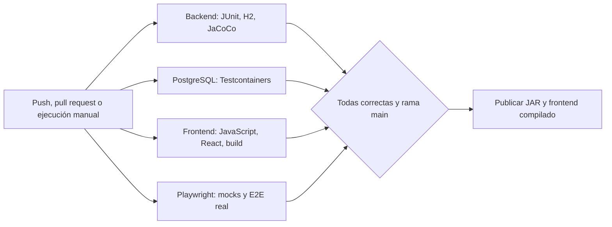

# CI/CD de Biblioteca Virtual

La **integración continua (CI)** ejecuta automáticamente las comprobaciones del
proyecto cuando cambia el código. La **entrega continua (CD)** de esta primera
fase prepara archivos descargables una vez superadas las comprobaciones; todavía
no despliega la aplicación en ningún servidor.

## Cuándo se ejecuta

El workflow `.github/workflows/ci.yml` se inicia al hacer push a `main`, al
abrir o actualizar una pull request hacia `main`, o manualmente desde la pestaña
**Actions** mediante **Run workflow**. Usa runners Ubuntu, Java 21 y Node 24.

## Comprobaciones

- **Backend** compila y ejecuta las pruebas habituales de JUnit y Mockito y las
  pruebas de integración H2 con `mvn test`. JaCoCo genera informes de cobertura.
- **PostgreSQL** comprueba Docker y ejecuta las clases `*Postgres*IT` mediante
  Testcontainers y PostgreSQL 17. Es una base temporal propia; no usa la base
  de desarrollo. JaCoCo se omite en este job para mantener separado el informe H2.
- **Frontend** ejecuta `npm ci`, las pruebas JavaScript con Node, los tests de
  componentes React y la compilación de Vite.
- **Playwright** ejecuta primero las pruebas de navegador con API simulada y
  después las E2E reales. Estas últimas levantan frontend, backend y un contenedor
  PostgreSQL temporal; usan Chromium, sesiones y API reales. No demuestran por sí
  solas concurrencia ni rendimiento.
- **Entrega** depende de los cuatro jobs anteriores y solo se ejecuta para
  `main` en un push o una ejecución manual. Genera el JAR ejecutable y `dist`.

Si un comando de pruebas falla, falla su job y la entrega no se ejecuta. Los
jobs independientes pueden ejecutarse en paralelo. La publicación de informes
se intenta también ante fallos; si la herramienta no llegó a crear archivos,
puede no haber informe para descargar.

## Consultar resultados y artefactos

En GitHub, abrir **Actions**, seleccionar **CI - Biblioteca Virtual** y entrar
en la ejecución deseada. Cada job muestra sus pasos y registros. En
**Artifacts**, cuando se hayan generado, se pueden descargar:

- `backend-informes`: informe JaCoCo HTML/XML/CSV y resultados de Surefire.
- `postgres-informes`: resultados de las pruebas PostgreSQL.
- `playwright-informes`: informe HTML E2E y capturas o trazas de fallos.
- `backend-jar` y `frontend-dist`: archivos de entrega, únicamente en `main`
  después de superar los controles obligatorios.

Los archivos se generan en cada ejecución de GitHub: los resultados locales
anteriores no demuestran que el workflow haya funcionado en el runner remoto.
No se han establecido mínimos de cobertura ni reglas de protección de rama.

## Rendimiento y siguiente paso de despliegue

Gatling se mantiene manual porque requiere un entorno aislado, datos preparados
y una decisión explícita sobre la carga; no se ejecuta en cada push. Sus
comandos están en `performance/README.md`.

Para automatizar un despliegue real faltan, entre otros, definir un entorno de
producción y su infraestructura, gestionar secretos, configurar el destino y
los permisos mínimos, y decidir cómo verificar y revertir una entrega. Este
workflow no publica releases ni modifica servidores.
