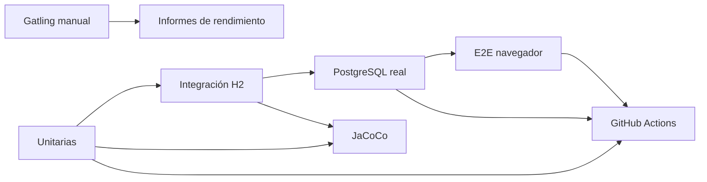

# Guía de testing, calidad y CI/CD de Biblioteca Virtual

Esta guía describe la configuración y los resultados disponibles en el espacio de trabajo el **19 de noviembre de 2026**. Una configuración existente no demuestra por sí sola que una ejecución haya pasado: se distingue lo ejecutado localmente de lo pendiente en GitHub. Los resultados generados en `target`, `dist` o `playwright-report` son temporales y pueden cambiar en una ejecución posterior.

## Índice

1. [Conceptos y mapa de pruebas](#1-conceptos-y-mapa-de-pruebas)
2. [Unitarias: JUnit y Mockito](#2-unitarias-junit-y-mockito)
3. [Integración con Spring Boot y H2](#3-integración-con-spring-boot-y-h2)
4. [PostgreSQL y Testcontainers](#4-postgresql-y-testcontainers)
5. [JavaScript y componentes React](#5-javascript-y-componentes-react)
6. [Navegador y E2E con Playwright](#6-navegador-y-e2e-con-playwright)
7. [Rendimiento con Gatling](#7-rendimiento-con-gatling)
8. [Cobertura con JaCoCo](#8-cobertura-con-jacoco)
9. [CI y CD con GitHub Actions](#9-ci-y-cd-con-github-actions)
10. [Cómo ejecutar las pruebas desde cero](#10-cómo-ejecutar-las-pruebas-desde-cero)
11. [Resultados y estado](#11-resultados-y-estado)
12. [Relación con el TFG](#12-relación-con-el-tfg)

## 1. Conceptos y mapa de pruebas

Una prueba automatizada prepara una situación, ejecuta una acción y compara su resultado con lo esperado mediante **aserciones**. Se puede repetir y detectar regresiones, aunque solo verifica los casos que se hayan diseñado.

| Tipo | Qué comprueba | Ejemplo en el proyecto | Límite |
|---|---|---|---|
| Unitaria | Una clase aislada y sus reglas | `PrestamoService` con repositorios simulados | Mockito no demuestra bloqueos ni SQL reales |
| Integración | Colaboración entre componentes | Spring, seguridad, JPA y H2 | H2 no reproduce todo PostgreSQL |
| PostgreSQL | Integración con el motor real | Índice parcial, transacciones y concurrencia | Una carrera ensayada no demuestra ausencia de todas las carreras |
| Componente | Interacción con una parte de la interfaz | Botón de préstamo en React | Un servicio simulado no verifica el servidor |
| E2E | Recorrido desde un navegador hasta la base | Registro, préstamo y devolución | Es más lenta y cubre solo los recorridos definidos |
| Rendimiento | Respuesta ante una carga definida | Búsquedas con Gatling y catálogos crecientes | Una prueba breve local no determina la capacidad de producción |

La **cobertura** mide qué partes del código se ejecutaron; es una ayuda para encontrar zonas no visitadas, no una medida directa de calidad. **CI** automatiza verificaciones al cambiar el código; la **entrega continua** prepara un resultado distribuible. Aquí no hay despliegue automático a producción.



## 2. Unitarias: JUnit y Mockito

**JUnit Jupiter** define y ejecuta pruebas Java; `@Test` marca un método de prueba y sus aserciones comparan resultados. **Mockito** crea dependencias simuladas: permite controlar qué devuelve un repositorio y comprobar cómo se utilizó, sin iniciar Spring ni una base. Se usan juntos para ejercitar reglas del servicio de forma rápida y aislada. Una entidad real conserva su comportamiento y estado; un mock representa una dependencia cuyo comportamiento configuramos.

El [POM del backend](../backend/pom.xml) usa Spring Boot 4.0.9 y Java 21. La gestión de dependencias de ese parent resuelve JUnit Jupiter **6.0.3** y Mockito **5.20.0**. Las pruebas están en [backend/src/test/java](../backend/src/test/java/): cinco clases `*UnitTests` tienen 44 métodos `@Test` y [EjemplarDevolucionTests](../backend/src/test/java/com/biblioteca/backend/catalogo/EjemplarDevolucionTests.java) añade dos pruebas aisladas con objetos reales; son 46 en esta clasificación, incluidas dentro de la suite habitual de 230 ejecuciones.

Con `@ExtendWith(MockitoExtension.class)`, `@Mock` crea un sustituto y `@InjectMocks` construye el servicio inyectándole mocks compatibles. `when(...).thenReturn(...)` prepara una respuesta; `verify(...)` comprueba una interacción; `assertEquals(...)` compara valores y `assertThrows(...)` comprueba la excepción. Algunas clases construyen el servicio explícitamente con `new`. No se ha localizado una llamada `Mockito.mock()` ni `mock()` en los tests Java inspeccionados: se usan principalmente anotaciones.

Ejemplo real, abreviado, de [PrestamoServiceUnitTests](../backend/src/test/java/com/biblioteca/backend/prestamo/PrestamoServiceUnitTests.java):

```java
@Test
void rechazaConCincoPrestamosActivosSinGuardar() {
    when(usuarios.findParaPrestamo(USUARIO_ID)).thenReturn(Optional.of(estudiante));
    when(prestamos.countByUsuarioIdAndEstado(USUARIO_ID, EstadoPrestamo.ACTIVO)).thenReturn(5L);

    assertThrows(LimitePrestamosException.class, () -> servicio.prestar(USUARIO_ID, LIBRO_ID));
    verify(prestamos, never()).saveAndFlush(any());
    assertEquals(EstadoEjemplar.DISPONIBLE, ejemplar.getEstado());
}
```

1. `@Test` identifica el caso; el nombre expresa la regla.
2. Los dos `when` simulan un estudiante y cinco préstamos activos.
3. `assertThrows` exige que la petición sea rechazada por el límite.
4. `verify(... never())` comprueba que no se intenta guardar el préstamo.
5. `assertEquals` verifica que el ejemplar real sigue disponible.

La clase también prueba el préstamo con cuatro activos, vencidos, ausencia de ejemplares y devoluciones, incluida la asignación a un estudiante elegible. [RenovacionServiceUnitTests](../backend/src/test/java/com/biblioteca/backend/prestamo/RenovacionServiceUnitTests.java) cubre las dos renovaciones, el límite, vencimiento, bloqueo y espera. [SolicitudEsperaServiceUnitTests](../backend/src/test/java/com/biblioteca/backend/espera/SolicitudEsperaServiceUnitTests.java) cubre alta y cancelación, y otras pruebas unitarias e integraciones comprueban la asignación FIFO. [AutenticacionServiceUnitTests](../backend/src/test/java/com/biblioteca/backend/auth/AutenticacionServiceUnitTests.java) y [CatalogoServiceUnitTests](../backend/src/test/java/com/biblioteca/backend/catalogo/CatalogoServiceUnitTests.java) cubren autenticación, gestión de libros y ejemplares.

La orden habitual `mvn test` también ejecuta integración H2; no es una orden exclusiva de unitarias. Surefire muestra pruebas ejecutadas, fallidas, errores y omitidas. Un caso rojo requiere leer la primera excepción y la aserción afectada.

## 3. Integración con Spring Boot y H2

Una prueba de integración comprueba que varias piezas trabajan juntas. `@SpringBootTest` inicia el contexto de Spring; `@AutoConfigureMockMvc` proporciona **MockMvc**, que ejercita controladores y filtros HTTP sin abrir un servidor de red. **Spring Security Test** facilita, entre otras cosas, representar usuarios y roles. **H2** es una base en memoria; el [perfil test](../backend/src/test/resources/application-test.properties) usa `jdbc:h2:mem:auth-tests` en modo de compatibilidad PostgreSQL. JPA describe entidades y repositorios, Hibernate implementa el acceso, y Flyway aplica las migraciones compatibles antes de validar el esquema.

En [CategoriasControllerIntegrationTests](../backend/src/test/java/com/biblioteca/backend/catalogo/CategoriasControllerIntegrationTests.java), una prueba guarda categorías y ejecuta este fragmento real:

```java
mvc.perform(get("/api/libros/categorias").with(user("alumno").roles("STUDENT")))
    .andExpect(status().isOk())
    .andExpect(content().contentTypeCompatibleWith("application/json"));
```

La petición atraviesa el controlador y la seguridad con un usuario de prueba, y la prueba completa comprueba el JSON ordenado. La clase usa `@Transactional` para revertir sus cambios. A diferencia del ejemplo Mockito anterior, aquí intervienen Spring y persistencia real en H2. Hay además pruebas de registro, seguridad, catálogo, préstamos, renovaciones y espera.

Desde `backend`, `.\mvnw.cmd test` o `mvn test` ejecuta la suite habitual y produce los informes de Surefire y JaCoCo. `@ParameterizedTest` puede ejecutar varios casos por método, por lo que contar anotaciones no equivale necesariamente a contar ejecuciones.

## 4. PostgreSQL y Testcontainers

**Docker** ejecuta procesos aislados en contenedores. **Testcontainers** crea y controla contenedores para pruebas; en este proyecto levanta PostgreSQL **17.11**, el motor real elegido. H2 es útil y rápida, pero no garantiza la misma semántica de índices parciales, bloqueos o concurrencia de PostgreSQL.

[PostgresTestConfiguration](../backend/src/test/java/com/biblioteca/backend/postgres/PostgresTestConfiguration.java) declara el contenedor y `@ServiceConnection` suministra sus datos a Spring Boot. [PostgresIntegrationTest](../backend/src/test/java/com/biblioteca/backend/postgres/PostgresIntegrationTest.java) configura URL de respaldo inaccesibles: la conexión válida procede del contenedor. Flyway aplica migraciones reales y Hibernate valida el esquema. Las pruebas preparan datos confirmados, comprueban identidad y limpian sus datos en el entorno temporal; no montan el volumen de desarrollo.

Las tres clases actuales `*Postgres*IT` contienen **20 pruebas**:

- `PostgresInfrastructureIT`: arranque, versión, esquema y migraciones, incluidas las específicas de PostgreSQL.
- `PostgresPrestamoRestriccionesIT`: índice parcial V10, fallo de inserción duplicada, `flush()` y conservación del historial.
- `PostgresConcurrenciaIT`: último ejemplar, doble devolución, devolución frente a préstamo, bloqueo pesimista y rollback tras `flush()` o error de asignación; también renovaciones simultáneas, renovación frente a devolución o reserva, desempate FIFO, dos devoluciones y cancelaciones.

En concurrencia se utilizan hilos coordinados, límites de espera y comprobaciones del estado persistido. No se garantiza que todas las intercalaciones posibles hayan ocurrido. El caso de cancelar una solicitud ya asignada también se comprueba de forma secuencial; no debe describirse como una carrera independiente.

Requisito: Docker Desktop en marcha. Desde `backend`:

```powershell
.\mvnw.cmd '-Dtest=*Postgres*IT' '-Djacoco.skip=true' test
```

El comando con `jacoco.skip=true` es el empleado en CI y preserva el informe H2. El comando histórico sin esa propiedad aparece en [PRUEBAS-POSTGRESQL.md](../backend/PRUEBAS-POSTGRESQL.md), pero sobrescribe los datos JaCoCo actuales. Si Docker falla, la suite debe fallar, no omitirse silenciosamente.

## 5. JavaScript y componentes React

[package.json](../frontend/package.json) define `test:unit` con el ejecutor de pruebas de Node y `test:components` con Vitest. Los tests JavaScript de [frontend/tests](../frontend/tests/) simulan `fetch` y comprueban contratos de servicios de sesión, catálogo, préstamos y reservas. Una respuesta HTTP simulada no demuestra la integración con Spring.

Las pruebas de componentes usan **Vitest 5.1.1**, **React Testing Library 16.3.3**, `user-event` y **jsdom 31.0.1**; React instalado es 19.3.1. Estas versiones proceden del árbol instalado y del lockfile; el manifiesto usa rangos. No se utiliza Jest como ejecutor.

Por ejemplo, [LoanButton.test.jsx](../frontend/tests/components/LoanButton.test.jsx) sustituye `requestLoan` con `vi.mock`, renderiza el botón y utiliza `user.click` para abrir y cancelar la confirmación. `expect(requestLoan).not.toHaveBeenCalled()` comprueba que cancelar no envía el préstamo. Otras pruebas verifican que los botones quedan deshabilitados mientras se espera una promesa y que el error se comunica sin anunciar éxito. Hay pruebas de formulario de registro, contexto de autenticación y préstamos del estudiante.

Desde `frontend`: `npm ci`, `npm run test:unit`, `npm run test:components` y `npm run build`. En PowerShell de Windows con scripts restringidos puede usarse `npm.cmd` en lugar de `npm`.

## 6. Navegador y E2E con Playwright

**End-to-End** significa recorrer varias capas desde el punto de vista del usuario. **Playwright** controla Chromium y permite localizar elementos por rol o texto, realizar clics y esperar automáticamente a que se cumplan condiciones. Las trazas permiten reconstruir una ejecución fallida; las capturas muestran el estado visual del navegador.

Hay dos grupos distintos:

1. `npm run test:browser`: cuatro escenarios en [tests/browser](../frontend/tests/browser/existing.spec.js) con respuestas API simuladas. Prueban interfaz, no integración completa.
2. `npm run test:e2e`: cinco recorridos en [recorridos.spec.js](../frontend/e2e/specs/recorridos.spec.js) con navegador, backend, sesión y PostgreSQL reales. [run-isolated.mjs](../frontend/e2e/run-isolated.mjs) crea un contenedor temporal identificado por etiqueta, levanta Spring Boot y Vite, carga pocos datos y limpia el contenedor propio. Usa puertos dinámicos y no reutiliza la base habitual.

Los recorridos reales cubren registro/login/logout; búsqueda, filtros y páginas; préstamo, dos renovaciones y devolución; devolución con asignación FIFO y cancelación de otra reserva; y gestión por personal frente a permisos de estudiante.

En el caso FIFO se crean tres contextos independientes: el primero toma el libro, los otros dos se apuntan, el primero devuelve y después se comprueba que el segundo queda `ASIGNADA` y el tercero `PENDIENTE`, antes de cancelar esta última. Los selectores `getByRole(...)` buscan controles accesibles y `await expect(...).toBeVisible()` espera el resultado; no es necesario copiar el archivo completo para entender el flujo.

La [configuración E2E](../frontend/playwright.config.js) usa Chromium, un trabajador, traza en fallos y capturas cuando falla. Tras `npm.cmd run test:e2e`, el informe está en `frontend/playwright-report/e2e/index.html` y los detalles en `frontend/test-results/e2e/`. La configuración simulada guarda fallos en `test-results/browser/`. Preparación: `npm.cmd ci`, `npx.cmd playwright install chromium`, Java 21, Maven y Docker. En Linux CI se instala Chromium con `--with-deps`.

## 7. Rendimiento con Gatling

**Gatling** es un generador de tráfico y análisis de respuestas. Este proyecto lo mantiene en el [módulo Maven independiente](../performance/pom.xml), con Java DSL **3.16.1** y plugin Maven **4.22.3**. Un **usuario virtual** es una secuencia simulada de acciones; una **simulación** define escenarios y su inyección. `Simulation` es la clase base, `ScenarioBuilder` describe acciones y `HttpProtocolBuilder` configura HTTP.

En [SesionInicialSimulation](../performance/src/test/java/com/biblioteca/performance/SesionInicialSimulation.java), `.exec()` envía peticiones; `.check()` valida respuestas; `.saveAs("csrf")` conserva el token en la sesión virtual; `.exitHereIfFailed()` detiene ese usuario al fallar. El flujo obtiene CSRF, inicia sesión, obtiene otro CSRF, consulta `/me` y catálogo y cierra sesión. Se ejecutó con un usuario: seis peticiones y cero errores.

[CatalogoSimulation](../performance/src/test/java/com/biblioteca/performance/CatalogoSimulation.java) ejercita catálogo, búsquedas por título y autor con `q`, categoría, disponibilidad, páginas y categorías. Limita los tamaños a 1.000, 5.000 y 10.000 libros y usuarios a 1, 5 y 10. Incluye rampa de 2 segundos, 18 segundos de concurrencia configurada, calentamiento de 5 segundos por usuario, consultas con pausas y duración máxima de 22 segundos. En la ejecución local se completaron nueve combinaciones sin errores; los tiempos globales incluyen login y calentamiento. Las ventanas son breves y se solapan, por lo que no constituyen una medición sostenida de capacidad.

**Carga** estudia un uso definido; **estrés** lleva el sistema hacia o más allá de sus límites; un **pico** aumenta usuarios o peticiones rápidamente. Estas ejecuciones fueron progresivas y acotadas, no una prueba de estrés extremo.

| Métrica | Interpretación |
|---|---|
| Media | Suma de tiempos dividida por número de solicitudes; puede ocultar valores lentos. |
| p50, p95, p99 | Aproximadamente el 50 %, 95 % o 99 % de las respuestas tardó como máximo ese tiempo. |
| Throughput / solicitudes por segundo | Cantidad procesada por unidad de tiempo; depende de pausas, duración y carga aplicada. |
| Usuarios concurrentes | Usuarios virtuales activos simultáneamente, no necesariamente solicitudes simultáneas. |
| Porcentaje de errores | Solicitudes fallidas dividido por el total; depende también de los checks definidos. |

[EntornoSeguro](../performance/src/test/java/com/biblioteca/performance/EntornoSeguro.java) exige un destino local y ejecuta [verificar-entorno.ps1](../performance/verificar-entorno.ps1) antes de la simulación. El [Compose propio](../performance/compose.yml) crea backend y PostgreSQL 17 con almacenamiento temporal y sin publicar la base al host. El verificador inspecciona contenedores, red, puertos y conexión; contrasta un marcador aleatorio en la base con la API autenticada y comprueba sesión y CSRF. Al alcanzar 10.000 libros modifica temporalmente un título existente y lo restaura para no exceder el límite. Es una protección para un entorno local controlado, no una defensa frente a quien pueda alterar Docker durante la ejecución.

Desde `performance`, ejecutar `powershell -NoProfile -ExecutionPolicy Bypass -File .\ejecutar.ps1` para la sesión mínima; añadir `-Catalogo` para las nueve combinaciones. No se usa la base de desarrollo ni se generan 100.000 libros. Los informes están en `performance/target/gatling/<ejecución>/index.html`. Para abrir el más reciente desde ese directorio:

```powershell
$informe = Get-ChildItem .\target\gatling -Filter index.html -Recurse | Sort-Object LastWriteTime -Descending | Select-Object -First 1
Invoke-Item $informe.FullName
```

## 8. Cobertura con JaCoCo

**JaCoCo 0.8.16** incorpora un agente Java antes de los tests y registra qué bytecode se ejecuta. El [POM](../backend/pom.xml) usa `prepare-agent` y genera HTML, XML y CSV tras `test`. Instrucciones son operaciones de bytecode; líneas agrupan instrucciones por línea fuente; ramas representan decisiones; métodos y clases cuentan elementos visitados. **N/A** significa que esa métrica no tiene elementos aplicables, por ejemplo una clase sin ramas; no significa 0 % ni 100 %.

El XML actual conserva los datos de la ejecución H2 del 19/11/2026: **767/779 líneas (98,5 %), 3.503/3.551 instrucciones (98,6 %), 147/154 ramas (95,5 %), 249/254 métodos (98,0 %) y 77/77 clases visitadas (100 %)**. Un `package -DskipTests` posterior pudo regenerar el informe usando esos mismos datos; no es una nueva medición. El informe no incluye la ejecución PostgreSQL de CI local, realizada con `jacoco.skip=true`.

Desde `backend`, ejecutar `.\mvnw.cmd test` y abrir `Invoke-Item .\target\site\jacoco\index.html`. El XML está en `target/site/jacoco/jacoco.xml`. En el código HTML, verde indica ejecución, rojo ausencia de ejecución y amarillo cobertura parcial de ramas. El detalle por clase está en el HTML y CSV. Aunque una clase muestre 100 %, puede haber aserciones insuficientes o combinaciones no ensayadas.

Entre las carencias observadas están la traducción de errores de integridad en `PrestamoService.prestar()` y en los métodos `guardar()` de gestión de libros y ejemplares; ya hay pruebas relacionadas con duplicados, por lo que conviene revisar qué aporta cada prueba nueva. También hay ramas parciales en renovación y asignación FIFO, y código defensivo de sesión. Los getters y `main` no ejecutados son menos prioritarios que las reglas de negocio. [COBERTURA.md](../backend/COBERTURA.md) explica la separación de informes: la configuración actual sobrescribe `jacoco.exec` en una nueva ejecución con agente; para combinar PostgreSQL e H2 harían falta archivos separados y `jacoco:merge` sobre los mismos binarios. No se han establecido umbrales.

## 9. CI y CD con GitHub Actions

**Integración continua** verifica cambios frecuentes. **Entrega continua** prepara un paquete para una publicación posterior; **despliegue continuo** lo instala automáticamente en un entorno. El proyecto implementa lo primero y una entrega de artefactos, no despliegue automático.

GitHub Actions ejecuta un **workflow** YAML formado por **jobs**, cada uno con **steps**, en un **runner**. Un **artefacto** es un archivo o carpeta que se conserva para descargar. El único workflow encontrado es [ci.yml](../.github/workflows/ci.yml): se activa en push a `main`, pull request hacia `main` o manualmente. Utiliza Ubuntu, Java 21 y Node 24; las acciones oficiales configuradas son checkout v7, setup-java v6, setup-node v7 y upload-artifact v7.

| Job | Función |
|---|---|
| `backend` | `mvn test`: unitarias, H2 y JaCoCo; publica informes cuando existen. |
| `postgres` | Comprueba Docker y ejecuta `*Postgres*IT` con Testcontainers; publica Surefire. |
| `frontend` | `npm ci`, tests Node y React, y `npm run build`. |
| `e2e` | Instala Chromium, ejecuta navegador simulado y E2E real; publica HTML y trazas disponibles. |
| `entrega` | Con `needs` de los cuatro anteriores, genera JAR y `dist` solo en `main`, en push o ejecución manual. |

Un fallo hace fallar su job y bloquea la entrega. `if: always()` intenta publicar informes incluso con fallo, pero si el archivo no llegó a generarse no puede adjuntarse. Las pull requests ejecutan comprobaciones, no entrega. Gatling no corre automáticamente: exige un entorno aislado y una decisión explícita sobre la carga.

El YAML pasó `actionlint` y sus comandos se probaron localmente, pero **no hay una ejecución GitHub verificada** en el material disponible. El workflow y varias pruebas están todavía sin seguimiento en el espacio de trabajo; GitHub solo podrá ejecutarlos después de que el usuario autorice incorporarlos al repositorio. Para revisar una ejecución futura: GitHub → **Actions** → **CI - Biblioteca Virtual** → ejecución → job y logs; los informes y paquetes aparecen en **Artifacts**. No hay despliegue, release ni reglas de protección de rama configuradas por este workflow. Véase también [CI-CD.md](CI-CD.md).

## 10. Cómo ejecutar las pruebas desde cero

Requisitos generales en Windows 11: Java 21, Maven o wrapper del backend, Node 24 compatible con el lockfile, Docker Desktop en marcha para PostgreSQL/E2E/Gatling y acceso a las imágenes necesarias. Abra PowerShell en la raíz del repositorio y sitúese en el directorio indicado. Los comandos del frontend usan `npm.cmd` y `npx.cmd` para evitar restricciones de scripts de PowerShell.

| Tipo | Tecnología | Directorio | Comando | Requisitos | Resultado |
|---|---|---|---|---|---|
| Unitarias Java | JUnit/Mockito | `backend` | `.\mvnw.cmd test` | Java 21 | Incluye unitarias **y** H2; no es exclusiva. |
| Integración H2 | Spring/MockMvc/H2 | `backend` | `.\mvnw.cmd test` | Java 21 | Misma ejecución anterior; no repetir para contarla dos veces. |
| PostgreSQL | JUnit/Testcontainers | `backend` | `.\mvnw.cmd '-Dtest=*Postgres*IT' '-Djacoco.skip=true' test` | Docker | Solo clases PostgreSQL, sin sobrescribir cobertura H2. |
| JavaScript | Node Test Runner | `frontend` | `npm.cmd run test:unit` | `npm.cmd ci` | Tests de servicios con `fetch` simulado. |
| React | Vitest/Testing Library | `frontend` | `npm.cmd run test:components` | `npm.cmd ci` | Tests de componentes en jsdom. |
| Navegador simulado | Playwright | `frontend` | `npm.cmd run test:browser` | Chromium, puerto 5179 libre | Cuatro escenarios con API simulada. |
| E2E real | Playwright/Spring/PostgreSQL | `frontend` | `npm.cmd run test:e2e` | Chromium, Docker, Java 21 y Maven | Contenedor temporal y cinco recorridos reales. |
| Sesión rendimiento | Gatling | `performance` | `powershell -NoProfile -ExecutionPolicy Bypass -File .\ejecutar.ps1` | Docker, Java 21 y Maven | Un usuario; informe HTML. |
| Catálogo rendimiento | Gatling | `performance` | `powershell -NoProfile -ExecutionPolicy Bypass -File .\ejecutar.ps1 -Catalogo` | Los mismos; ejecución explícita | Nueve etapas, máximo 10.000 libros y 10 usuarios. |
| Cobertura | JaCoCo | `backend` | `.\mvnw.cmd test` | Java 21 | Genera HTML/XML/CSV para la misma suite H2. |
| CI | GitHub Actions | GitHub | Actions → Run workflow | Código y workflow disponibles en GitHub | Resultados remotos y artefactos, si se generan. |

Preparación del frontend, una vez situado en `frontend`:

```powershell
npm.cmd ci
npx.cmd playwright install chromium
```

La suite habitual y la PostgreSQL deben ejecutarse por separado. Si se desea ejecutar solo una clase Java, Surefire admite `-Dtest=NombreDeClase`, pero ese filtro no se ejecutó durante la elaboración de esta guía. El E2E requiere Maven disponible en `PATH`, porque su lanzador lo invoca directamente. Las pruebas de rendimiento se lanzan solo cuando se desean medir, no como requisito de cada cambio.

## 11. Resultados y estado

| Grupo | Último resultado conocido | Evidencia y alcance |
|---|---|---|
| Backend habitual | 230 superadas, 0 fallidas, 0 omitidas | `backend/target/ci-backend.log`, ejecución local del 19/11/2026; incluye unitarias y H2. |
| PostgreSQL | 20 superadas, 0 fallidas, 0 omitidas | `backend/target/ci-postgres.log`, ejecución local con Testcontainers; no sumarlas a las 230 como si fueran la misma suite. |
| JavaScript | 128 superadas | Ejecución local comunicada en la validación anterior; la guía no ha repetido los tests. |
| React | 11 superadas | Ejecución local comunicada en la validación anterior. |
| Navegador simulado | 4 superadas | Ejecución local comunicada en la validación anterior; API simulada. |
| E2E real | 5 superadas | `backend/target/ci-e2e.log` y `frontend/playwright-report/e2e/index.html` actuales; ejecución local. |
| JaCoCo | 98,5 % líneas; 95,5 % ramas | XML actual; datos de la ejecución H2, no cobertura combinada PostgreSQL. |
| Gatling | Sesión: 6 solicitudes correctas; catálogo: 9 etapas, 0 errores | Resultados de ejecución local anterior; el registro de catálogo existe en `performance/target/catalogo-progresivo.log`. |
| GitHub Actions | Workflow implementado y validado estáticamente | Pendiente de ejecutar en GitHub; no afirmar que CI remota ha pasado. |

Los logs e informes de `target` y del frontend no son fuentes versionadas y pueden reemplazarse. Los 46 tests unitarios aislados son parte de las 230 ejecuciones habituales; no deben sumarse a ellas. Las pruebas PostgreSQL corresponden a otra ejecución. La cobertura tampoco debe sumarse al número de tests.

## 12. Relación con el TFG

La estrategia combina pruebas a distintas escalas para reducir riesgos diferentes. JUnit y Mockito permiten aislar las reglas de préstamos, renovaciones, autenticación y reservas: una prueba puede imponer un límite y comprobar tanto el rechazo como la ausencia de guardado. Las pruebas de entidades reales complementan esos casos al verificar transiciones de estado sin depender de mocks.

Las integraciones con Spring Boot y H2 verifican que controladores, seguridad, servicios, repositorios y mapeos colaboran. La base en memoria facilita ejecuciones repetibles, mientras que MockMvc permite ejercitar solicitudes y respuestas con filtros de seguridad. Esta capa no sustituye la validación del motor utilizado en producción. Por ello, Testcontainers levanta PostgreSQL 17 temporal y ejecuta migraciones, restricciones y escenarios concurrentes sobre el motor real, incluyendo el índice parcial que limita préstamos activos.

En el frontend, Node prueba la lógica de servicios y Vitest con Testing Library comprueba componentes y estados visibles. Las pruebas de navegador con API simulada ayudan a diagnosticar la interfaz; los recorridos E2E reales comprueban la comunicación con el backend y una base aislada. Estos niveles se complementan: un test de componente rápido identifica una regresión local, mientras un E2E puede detectar un problema en la unión de capas.

Gatling aporta una visión temporal de operaciones reales bajo cargas controladas. Sus informes muestran distribuciones y errores, pero las ejecuciones actuales son cortas, locales y con pocos usuarios; no deben presentarse como capacidad de producción. JaCoCo muestra qué código se ejecutó y ayuda a seleccionar casos ausentes, sin garantizar la corrección. Finalmente, el workflow de GitHub Actions describe cómo repetir verificaciones y preparar artefactos sin desplegar; su primera ejecución remota aún debe comprobarse.

El sistema reduce el riesgo de regresiones en los escenarios definidos, pero no prueba todas las combinaciones, todos los navegadores ni todas las intercalaciones concurrentes. Como mejoras futuras caben revisar rutas de integridad no ejecutadas, validar el workflow en GitHub, separar y combinar conscientemente la cobertura PostgreSQL, ampliar la observabilidad de rendimiento y definir un entorno de despliegue con secretos, controles y reversión. Las decisiones deben priorizar riesgos reales y no perseguir porcentajes por sí mismos.
